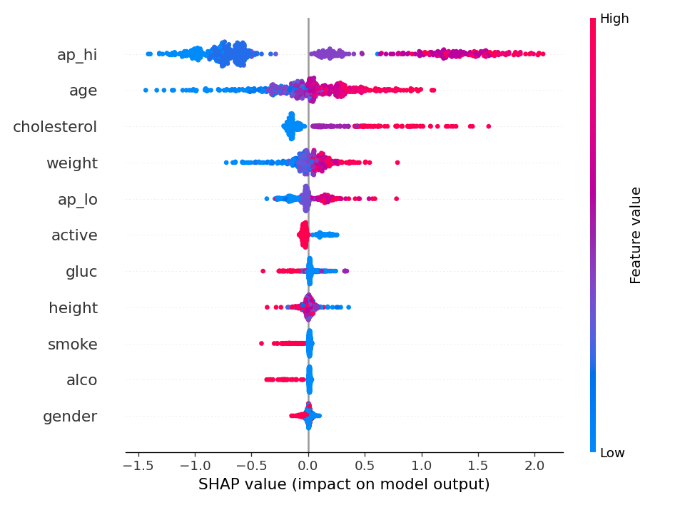

# Cardiovascular Disease Classification

[](https://github.com/kiselyovd/cardio-risk-rf/actions/workflows/test.yml) · [Docs](https://kiselyovd.github.io/cardio-risk-rf/)

Classify the **presence of cardiovascular disease at medical examination** from the Sulianova dataset's 11 features. LightGBM is the main estimator; RandomForest with median imputation is the baseline. The historical repository name is retained.

[Model and weights](https://huggingface.co/kiselyovd/cardio-risk-rf) · [Evaluation protocol](docs/EVALUATION.md) · [Русский](README.ru.md)

## Results

<!-- ARTIFACT-MANIFEST:START -->
### Current artifact and evaluation

**Replayed on the original 10501-row test fold, legacy seed42 protocol**

| Metric | Value |
|---|---:|
| LightGBM ROC-AUC | 79.77% |
| LightGBM average precision | 78.11% |
| RF ROC-AUC | 79.49% |
| RF average precision | 77.94% |

Target is CVD presence at examination. The exact legacy split is 48999/10500/10501; original training row membership is unrecorded. Average precision uses sklearn AP.

[Evaluation record](https://github.com/kiselyovd/cardio-risk-rf/blob/main/reports/replay-native.json) · [Pinned model](https://huggingface.co/kiselyovd/cardio-risk-rf/tree/a0117e88461cf4197a2a604203f68dde23fd069a)
<!-- ARTIFACT-MANIFEST:END -->

The source CSV, exact row split, model hashes and prediction arrays accompany the [new replay](reports/replay-native.json). Average precision is the sklearn AP measure; thresholds use 0.5. This is a retrospective research classifier, with no prospective ten-year horizon or clinical validation.

## Run the published artifact

The canonical files are **dict bundles** with `model`, `best_params` and `cv_pr_auc`. The fitted estimator is `bundle["model"]`. Only deserialize trusted model files after verifying their identity.

```python
import hashlib
import joblib
import pandas as pd
from huggingface_hub import hf_hub_download

REPO = "kiselyovd/cardio-risk-rf"
REVISION = "a0117e88461cf4197a2a604203f68dde23fd069a"
path = hf_hub_download(REPO, "cardio_risk_lgbm.joblib", revision=REVISION)
with open(path, "rb") as stream:
    assert hashlib.file_digest(stream, "sha256").hexdigest() == "d0b96ed0fb1209be8ed73ebb41d41225d6d106c2f291a285c6c9fc8950a2ad39"
model = joblib.load(path)["model"]
# Synthetic interface example; age is rounded years, not the raw CSV's days.
row = pd.DataFrame([dict(
    age=54, gender=2, height=175, weight=80, ap_hi=130, ap_lo=85,
    cholesterol=1, gluc=1, smoke=0, alco=0, active=1,
)]).astype(float)
print(float(model.predict_proba(row)[0, 1]))  # score for source label cardio=1
```
## Data and replay

```bash
uv sync --frozen --all-groups
uv run --frozen python scripts/fetch_data.py
uv run --frozen python -m cardio_risk_rf.data.prepare --raw data/raw/cardio.csv --out data/processed
uv run --frozen python -m cardio_risk_rf.evaluation.replay --csv data/raw/cardio.csv
```

The original archive contains `cardio_train.csv`; the helper keeps the historical local name `cardio.csv`. It verifies archive and CSV hashes without requiring credentials or an unverified dataset mirror.

The released RF records 48,999 training rows. The legacy sklearn float/ceil recipe yields **48,999 train / 10,500 validation / 10,501 test** rows. It is intentionally preserved for replay; a split change requires a new protocol version. Raw age in days is converted with `round(age / 365.25)` before inference. Preparation rejects stale output directories and saves row membership and hashes.

## Explanations



Model attributions on a recorded validation sample explain the fitted model's associations. The endpoint returns local top-five contributions. [Feature units and limitations](docs/EVALUATION.md).

## Train or serve locally

```bash
make train     # scripts/train_all.py: Optuna main + RF grid search
make evaluate  # canonical joblib and test.parquet arguments
make serve     # FastAPI on port 8000; requires the two local model artifacts
```

The container expects `artifacts/main/cardio_risk_lgbm.joblib` and `artifacts/baseline/cardio_risk_rf.joblib` mounted read-only; model weights are not baked into its image. [Serving](docs/serving.md) · [Training](docs/training.md).

## Terms and provenance

Project software is MIT. The original dataset publisher lists its license as **Unknown**; this repository does not assign MIT or Framingham's terms to those rows. The model Hub declaration and source-data terms are separate. [Component details](docs/LICENSES.md) · [CITATION.cff](CITATION.cff).

The legacy Framingham/TenYearCHD loader and the earlier 49-row experiment are retained as historical material; neither describes the released 11-feature models. Numerical result blocks are generated from `artifact-manifest.json`; CI detects report/README drift.
